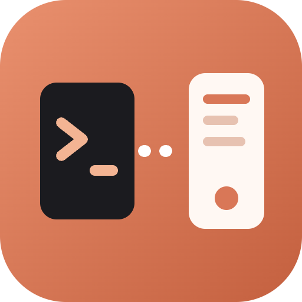
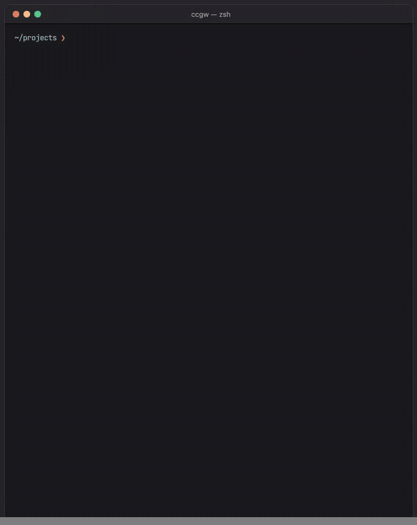
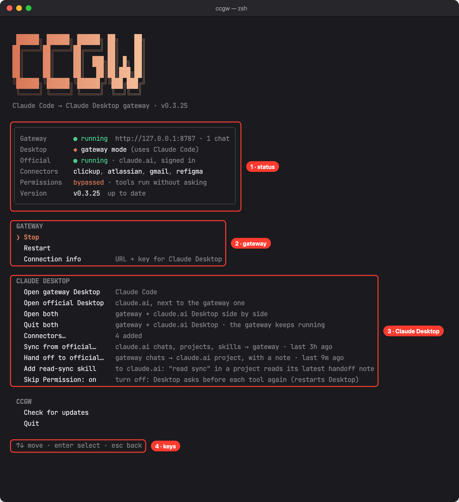
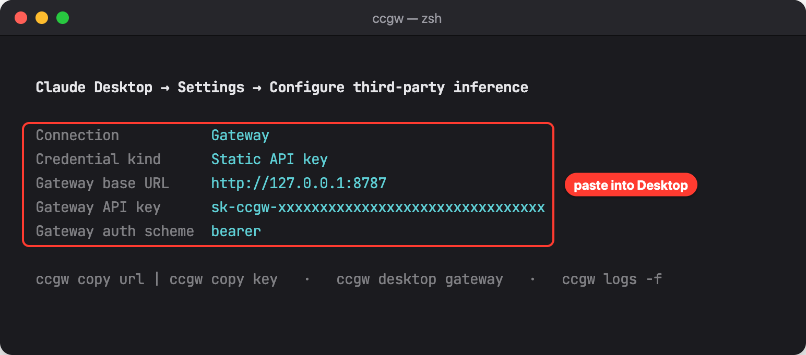
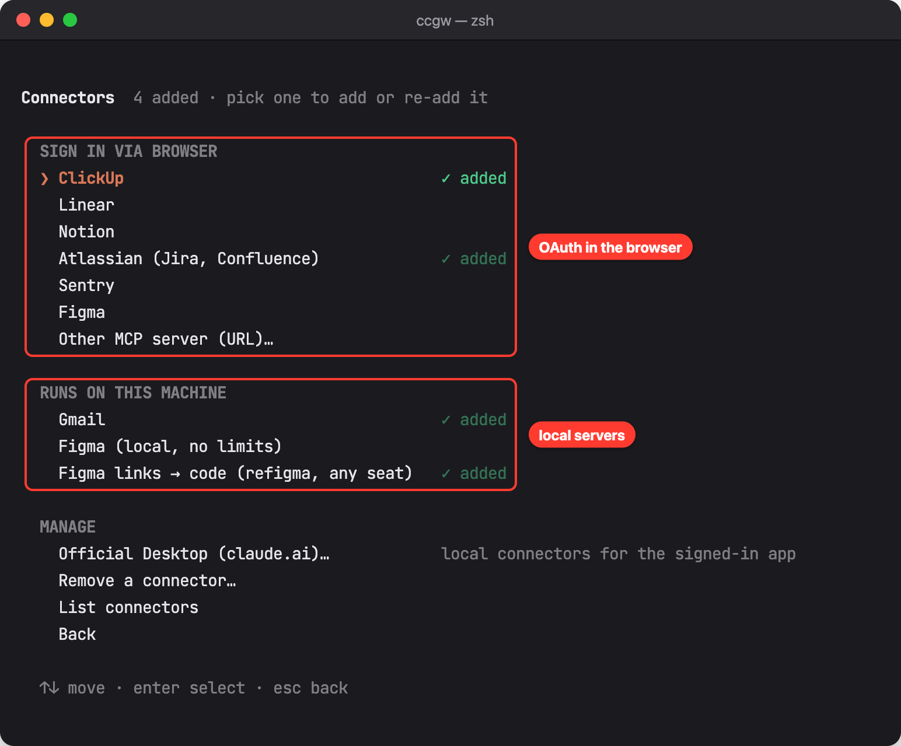
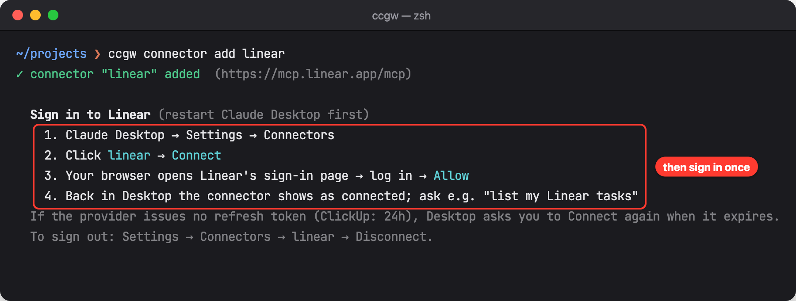
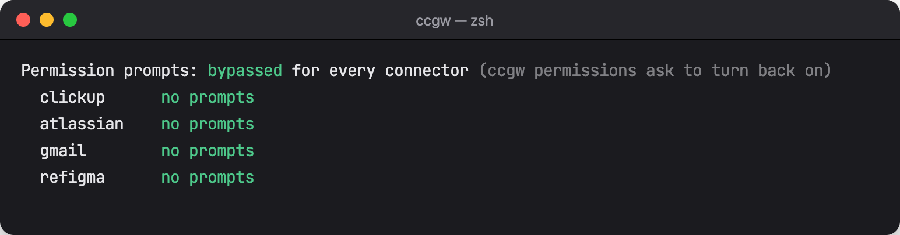
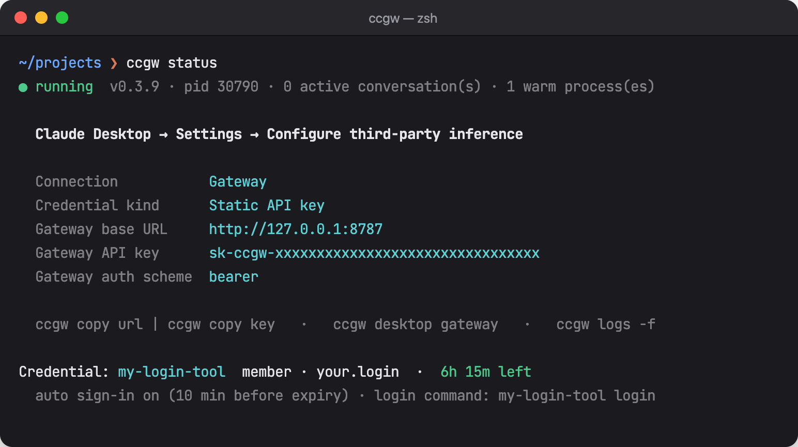
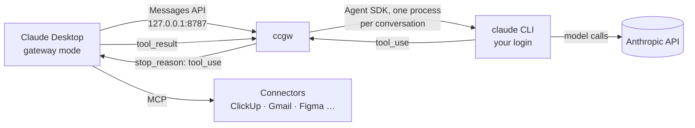

<div align="center">



# ccgw

**Run Claude Desktop on your Claude Code login.**

A local gateway that turns your logged-in `claude` CLI into the inference backend for Claude Desktop.
Chat, Cowork, tool calls and artifacts in Desktop all run through Claude Code, plus the connectors you add from the terminal.

<p>
  
  
  
  
  
</p>

<a href="#features">Features</a> ·
<a href="#getting-started">Getting started</a> ·
<a href="#guide">Guide</a> ·
<a href="#connectors">Connectors</a> ·
<a href="#how-it-works">How it works</a> ·
<a href="#reference">Reference</a>

<br /><br />



</div>

---

## Features

### 🔌 A gateway for Claude Desktop
- Desktop's **Configure third-party inference → Gateway** points at `http://127.0.0.1:8787`, and every request runs through your installed `claude`: your login, your plan, the newest CLI.
- **Tool calls are bridged**, so Desktop's own tools, Cowork and artifacts work as usual.
- **Fast follow-ups**: one CLI process stays alive per conversation, and a pre-warmed process is ready for the next new one.
- **1M context** models are exposed when your account has them (`expose1m`).

### 🖥️ One menu for everything
Run `ccgw` with no arguments and you get a status panel (gateway, login, Desktop mode, connectors, permission prompts, version) above numbered actions. Every item is also a plain command for scripts.

### 🔁 Switch Desktop modes without logging out
`ccgw desktop gateway` / `ccgw desktop login` flips Claude Desktop between the gateway and your claude.ai account. Both sessions survive the switch.

### 🪟 Gateway and claude.ai side by side
`ccgw desktop official` opens a second Claude Desktop signed in to your claude.ai account next to the gateway one (macOS and Windows). `ccgw desktop open` opens the gateway one. Restarting either never logs the other out.

### 🧩 Connectors from the terminal
Gateway mode has no claude.ai connector directory, so ccgw adds them for you:

| | |
|---|---|
| **Sign in via browser** | ClickUp, Linear, Notion, Atlassian (Jira/Confluence), Sentry, Figma, or any remote MCP URL. OAuth runs in Desktop. |
| **Gmail** | A local MCP server over the Gmail API: search, read, send, draft, labels. |
| **Figma, no plan limits** | `figma-local` drives Figma Desktop through a plugin, so nothing counts against Starter quotas. |
| **Figma links → code** | `refigma` turns a Figma link into HTML / React + Tailwind, SVG and tokens. A View seat is enough. |
| **Permission prompts** | Skip Desktop's *"Claude wants to use…"* prompt per connector or for all of them. |

### 🔑 Logins from another tool
If a team tool keeps your Claude Code login fresh, ccgw shows who is signed in and how long is left, and can open the login window before it expires.

### ⬆️ Self-updating
`ccgw update` installs the latest release and restarts the gateway. ccgw checks for a new release at most once a day and only tells you; it never installs anything by itself.

---

## Getting started

### Requirements
- **Node.js 18.17+**
- **[Claude Code](https://docs.anthropic.com/en/docs/claude-code) CLI**, logged in (`claude` → `/login`)
- **Claude Desktop**

### Install

macOS / Linux:

```bash
curl -fsSL https://raw.githubusercontent.com/haonguyenstech/ccgw/main/install.sh | sh
```

Windows (PowerShell):

```powershell
irm https://raw.githubusercontent.com/haonguyenstech/ccgw/main/install.ps1 | iex
```

Pin a version with `CCGW_VERSION=0.3.9` (sh) or `$env:CCGW_VERSION = "0.3.9"` (PowerShell).
Uninstall: `ccgw stop; npm uninstall -g ccgw`.

### Two commands

```bash
ccgw start             # start the gateway in the background
ccgw desktop gateway   # write the "Claude Code (ccgw)" profile and switch Desktop to it
```

That's it: Claude Desktop restarts and answers through Claude Code. The gateway does not start at login, so run `ccgw start` (or `ccgw`) again after a reboot.

---

## Guide

### 1. The menu

```bash
ccgw
```



| | |
|---|---|
| **1 · Status** | Is the gateway running, who is logged in and for how long, which mode Desktop is in, which connectors are added, whether permission prompts are on, and whether a newer ccgw exists. |
| **2 · Gateway** | Start / stop / restart, show the URL and key, sign in with your login tool. |
| **3 · Claude Desktop** | Switch modes, add or remove connectors, turn permission prompts on or off. |
| **4 · Keys** | <kbd>↑</kbd>/<kbd>↓</kbd> move, <kbd>Enter</kbd> runs, a **number** jumps straight to an item, <kbd>Esc</kbd> goes back, <kbd>q</kbd> quits. |

### 2. Connect Claude Desktop by hand (optional)

`ccgw desktop gateway` does this for you. To set it up yourself, print the values:

```bash
ccgw info              # or menu → 3 · Connection info
```



Then in Claude Desktop → **Settings → Configure third-party inference**, fill in:

| Field | Value |
| --- | --- |
| Connection | Gateway |
| Credential kind | Static API key |
| Gateway base URL | `http://127.0.0.1:8787` |
| Gateway API key | from `ccgw info` (`ccgw copy key` puts it on the clipboard) |
| Gateway auth scheme | bearer |

> 📌 The key lives in `~/.ccgw/config.json`. `ccgw rotate-key` makes a new one; paste it into Desktop again afterwards.

### 3. Add a connector

Open **6 · Connectors…** in the menu and pick one, or run `ccgw connector add <preset>`.



For OAuth connectors, ccgw writes the entry, restarts Desktop and tells you how to sign in:



1. Claude Desktop → **Settings → Connectors**
2. Click the connector → **Connect**
3. The browser opens the provider's sign-in page → log in → **Allow**
4. Back in Desktop it shows as connected. Try *"list my Linear tasks"*.

> 📌 Each `connector add` restarts Claude Desktop to load it. Add `--no-restart` if you are in the middle of a conversation and restart it yourself later.

### 4. Skip permission prompts (optional)

Desktop asks *"Claude wants to use …"* before every connector tool. See and change that per connector:

```bash
ccgw permissions                       # show the setting per connector
ccgw permissions bypass                # every connector, including ones added later
ccgw permissions bypass figma-local    # just one
ccgw permissions ask                   # prompt again
```



> 📌 Tools then act without asking, including sending email or editing designs. It restarts Desktop to apply (`--no-restart` skips that). `connector add <preset> --allow` sets it for one new connector.

### 5. Check on it

```bash
ccgw status
```



`ccgw logs -f` follows the log at `~/.ccgw/gateway.log`.

---

## Connectors

Connectors live in the "Claude Code (ccgw)" profile, so they work the same on macOS and Windows.

| Preset | What | Sign-in |
| --- | --- | --- |
| `clickup`, `linear`, `notion`, `atlassian` (Jira/Confluence), `sentry`, `figma` | the provider's remote MCP server | OAuth in the browser, from Desktop |
| `gmail` | local MCP server over the Gmail API | your own Google OAuth client, once |
| `figma-local` | Figma Desktop through a plugin, **no plan limits** | none; run the plugin in Figma |
| `refigma` | Figma links → HTML / React + Tailwind, SVG, tokens via [refigma-mcp](https://github.com/haonguyenstech/refigma-mcp); a **View seat** is enough | macOS: your figma.com session in Edge; Windows: sign in once in an Edge window |

> 🪪 **The official Desktop too.** `ccgw connector add refigma --official` (or *Connectors… → Official Desktop*) puts a local connector in the claude.ai-signed-in Desktop instead, in its own `claude_desktop_config.json`. Only the official Desktop is restarted, and it stays signed in; the gateway Desktop and its profile are left alone. Remote connectors for that one come from your claude.ai account (its *Settings → Connectors*), so `--official` takes only `refigma`, `gmail` and `figma-local`, and they run in that Desktop on this machine, not on claude.ai web or mobile.

<details>
<summary><b>Remote connectors (OAuth)</b></summary>

Desktop registers itself with the provider and opens its sign-in page. There are no API keys and nothing to install.

```bash
ccgw connector add clickup
```

Then follow the four sign-in steps in [Add a connector](#3-add-a-connector).

Providers that issue refresh tokens stay signed in. ClickUp does not (its token lasts 24h), so Desktop asks you to **Connect** again about once a day.
*Settings → Connectors → clickup → Disconnect* signs out.

Figma only accepts allowlisted OAuth clients, so for `figma` ccgw registers the client itself and writes its id into the profile (callback `127.0.0.1:53282`). On Figma's free Starter plan that server allows only a few calls a month, so use `figma-local` instead.

Any other remote MCP server: `ccgw connector add <name> --url https://…/mcp`
(OAuth by default; `--header "Authorization: Bearer …"` for token-based servers).

</details>

<details>
<summary><b>Gmail (<code>gmail</code>)</b></summary>

Gmail runs locally: ccgw ships a small stdio MCP server over the Gmail API (search, read messages and threads, send, draft, labels, trash). Google's own Gmail MCP server only serves Cloud projects enrolled in its Workspace Developer Preview, so ccgw does not use it. Google has no automatic client registration, so bring your own OAuth client:

1. [Google Cloud console](https://console.cloud.google.com) → pick or create a project
2. Enable the Gmail API: `gcloud services enable gmail.googleapis.com`
   (or APIs & Services → Library → Gmail API)
3. OAuth consent screen → External → add yourself under **Test users**
4. Credentials → Create credentials → OAuth client ID → **Desktop app** → download the JSON
5. `ccgw connector add gmail --client-json ~/Downloads/client_secret_….json`
   (or `--client-id <id> --client-secret <secret>`)

Step 5 opens Google's sign-in in the browser, stores the refresh token in `~/.ccgw/gmail.json` (mode 600) and restarts Desktop. There is no Connect step.
`ccgw gmail status | login | logout` manages the sign-in.

> 📌 While the consent screen is in *Testing*, Google expires the refresh token after 7 days. Publish the app (it stays unverified, which is fine for your own account) to avoid that.

</details>

<details>
<summary><b>Figma without plan limits (<code>figma-local</code>)</b></summary>

Figma's remote MCP server allows only a few calls a month on the free Starter plan, and its REST API is capped the same way. `figma-local` goes through Figma Desktop instead: a plugin uses the Plugin API, so nothing is counted. It reads files, selections, styles and components, exports images, and can edit designs.

```bash
ccgw connector add figma-local   # installs the bridge into ~/.ccgw/figma
```

This also adds the plugin to Figma Desktop's development plugins. Figma rewrites its settings when it quits, so if it is open ccgw asks to restart it (`--restart-figma` skips the question). Otherwise, quit Figma and run `ccgw figma plugin`, or import it by hand: open a file → **Plugins → Development → Import plugin from manifest…** → `~/.ccgw/figma/plugin/manifest.json`.

From then on, run **Plugins → Development → ccgw Figma Bridge** in the file Claude should see. It connects by itself and reconnects when Desktop restarts. If it is not running, Figma tools fail at once and Claude asks you to start it. `ccgw figma status` shows whether the relay is up and the plugin connected.

How it works: it is [Talk to Figma](https://github.com/grab/cursor-talk-to-figma-mcp) (MIT). ccgw installs its MCP server (pinned to 0.3.5) into `~/.ccgw/figma`, pins it to one channel so there is nothing to join, and runs the WebSocket relay itself on `localhost:3055` (IPv4 and IPv6 loopback, never the LAN; no Bun). The plugin copy in [`figma-plugin/`](figma-plugin/) has its usage analytics removed. With the plugin open in several files, commands go to the one where it was started last. Figma Desktop must be running; the first `connector add` needs npm and network access.

</details>

<details>
<summary><b>Figma links to code, any seat (<code>refigma</code>)</b></summary>

`figma-local` needs a seat that can run plugins. [refigma-mcp](https://github.com/haonguyenstech/refigma-mcp) reads a Figma link through a headless Microsoft Edge signed in to figma.com, so a View seat works and nothing counts against an API quota. It returns the layout tree, HTML / React + Tailwind, SVG icons, design tokens and Figma's own PNG, and can pixel-diff your implementation against that PNG. It only reads; it does not edit designs.

```bash
ccgw connector add refigma                        # latest release, via npx
ccgw connector add refigma --version 0.4.0        # pin a release
ccgw connector add refigma --path ~/refigma-mcp   # run a local checkout
```

Needs Microsoft Edge, Node ≥ 22.15 and Python 3 (on macOS with `cryptography`). ccgw checks these and starts the server once before writing the entry, so npx's first download does not happen inside Desktop's startup. The entry stays on the version it was added with; run the same command again to move to the latest release. Then paste a link (right-click a frame → *Copy link to selection*) and ask, e.g. *"turn this frame into React"*.

Signing in to figma.com:

- **macOS**: refigma copies the session from your Edge. The first Figma call asks for the Keychain (to read Edge's cookies): click **Allow**.
- **Windows**: Edge's cookies cannot be copied there (app-bound encryption), so on the first call Claude runs `figma_relogin`, which opens an Edge window at figma.com/login. Sign in once; refigma's own profile keeps the session. Python is found even when it is not on PATH; without one, ccgw offers to install Python 3.12 from python.org for your user (no admin), and `--install-python` skips the question. The entry records python.exe's path, so Desktop's PATH does not matter. Windows needs refigma-mcp 0.5.0 or later.

</details>

---

## Login from another tool (credential provider)

If something other than `claude /login` keeps your Claude Code login fresh (say a team tool that hands out a shared login and keeps it current while its terminal window stays open), tell ccgw about it:

```sh
ccgw credential set --login "my-tool login" --status "my-tool whoami" --auto-login
ccgw restart
```

- The menu and `ccgw status` show who is signed in (first line of `--status`) and how long the login has left.
- **Sign in with my-tool** (menu) or `ccgw credential login` runs the login command right in the current terminal; quit it to get back to the menu. `--window` opens it in a new terminal window instead.
- With `--auto-login`, the gateway opens that window by itself 10 minutes before the login runs out (`--renew-minutes N`), once per token, unless it is already running.
- Once the login has expired, Claude Desktop gets a plain error saying so instead of an obscure API failure.

`ccgw credential auto on|off` toggles the automatic window, `ccgw credential unset` removes the provider.

---

## How it works



- Serves `GET /v1/models`, `POST /v1/messages` (stream + non-stream) and `POST /v1/messages/count_tokens` (estimate). Listens on `127.0.0.1` only.
- Each request runs through your installed `claude` via the Claude Agent SDK, so it uses your Claude Code login and the newest CLI version.
- **Tool calling is bridged**: Desktop's tools are exposed to the CLI as an in-process MCP server. When the model calls one, the CLI blocks in that handler, the HTTP response ends with `stop_reason: tool_use`, and the next request's `tool_result` unblocks the same CLI process.
- **Speed**: one CLI process per conversation stays alive, so a follow-up is a single prompt write (no history replay), and a pre-warmed process per recent system prompt removes spawn latency for new conversations.
- Desktop/Cowork quirks handled: mid-conversation `role: "system"` messages, the client's `x-anthropic-billing-header` system block (stripped), tool names longer than 64 chars after the MCP prefix (aliased).
- Errors map to Messages-API types (`rate_limit_error` 429, `overloaded_error` 529, …) so clients back off and retry.

### Switching Desktop modes without logging out

Desktop keeps each mode in its own data dir: claude.ai login in `~/Library/Application Support/Claude` (`%APPDATA%\Claude` on Windows), gateway in `…/Claude-3p` (`%LOCALAPPDATA%\Claude-3p`). It picks one from `deploymentMode` in `Claude-3p/claude_desktop_config.json`. Switching from Desktop's own UI goes through sign-out and clears credentials; `ccgw desktop login|gateway` quits Desktop, flips the key and reopens it, so both sessions survive.

### Running both at once

Desktop reads the mode only when it starts, and keeps one process per data dir.

- **macOS**: the official instance runs from its own data dir (`--user-data-dir=~/Library/Application Support/Claude-Official`), which reads its mode from `Claude-Official-3p/`, set to `1p`. Desktop does not refuse a second process on the same dir, so ccgw brings a running instance forward by pid instead of launching it again, and quits the gateway one by pid so the official one is never hit. Signing in ends with a `claude://` link that macOS hands to the gateway Desktop, which drops it, so the first sign-in closes the gateway Desktop until it is done and reopens it after.
- **Windows**: Desktop always reads the mode from `%LOCALAPPDATA%\Claude-3p`, and the Store (MSIX) build takes no arguments or environment from outside. So the official instance is Desktop's own claude.ai-mode one (`%APPDATA%\Claude`): ccgw sets the mode to `1p`, starts it, and sets `3p` back once it is up. The two are told apart by their child processes' data dir. A sign-in link starts a new Desktop process that picks its data dir from the mode and hands the link to the instance holding it, so the mode stays `1p` until you are signed in; the gateway Desktop keeps running.

### Limits

- Usage counts against the Claude Code account's plan limits. Cowork sends a ~100K-token system prompt at the start of each conversation.
- `temperature`, `max_tokens` and `stop_sequences` are not forwarded (the CLI owns sampling). Model and thinking budget are.
- If Desktop edits history (retry/branch from an earlier message), the conversation restarts in a fresh CLI process with prior turns flattened to text, so images from earlier turns are dropped.
- The gateway does not start at login; run `ccgw start` after a reboot.
- `figma-local` is tested on macOS; on Windows it is untested with a real Figma Desktop.

---

## Reference

| Command | |
| --- | --- |
| `ccgw` | interactive menu |
| `ccgw start [--port N] [-f]` | start in background (`-f` foreground) |
| `ccgw stop` / `restart` / `status` | |
| `ccgw info` | print Base URL / API key / auth scheme |
| `ccgw copy url\|key` | copy to clipboard |
| `ccgw desktop gateway` | switch Desktop to gateway mode (starts ccgw, writes + selects the "Claude Code (ccgw)" profile) |
| `ccgw desktop login` | switch Desktop back to claude.ai login mode |
| `ccgw desktop toggle` / `status` | flip modes / show current mode |
| `ccgw desktop open` | open the gateway Desktop (starts ccgw; restarts Desktop only if it needs switching) |
| `ccgw desktop official [--sign-in]` | open a claude.ai-signed-in Desktop next to the gateway one; the first time (or with `--sign-in`) it waits for you to sign in |
| `ccgw desktop official status` / `quit` | is it running and signed in / quit it, keeping the sign-in |
| `ccgw connector add <preset>` | add a connector to Desktop, see [Connectors](#connectors) |
| `ccgw connector list` / `remove <name>` | |
| `ccgw connector add <preset> --official` | add a local connector (`refigma`, `gmail`, `figma-local`) to the official Desktop instead; `list` / `remove` take `--official` too |
| `ccgw permissions [bypass\|ask] [name]` | skip or restore Desktop's per-tool permission prompts |
| `ccgw figma status` / `plugin [--restart-figma]` | check the `figma-local` bridge / add the plugin to Figma Desktop |
| `ccgw gmail status\|login\|logout` | manage the `gmail` sign-in |
| `ccgw credential set\|status\|login\|auto\|unset` | login from another tool, see [above](#login-from-another-tool-credential-provider) |
| `ccgw rotate-key` | new API key (paste it into Desktop again) |
| `ccgw logs [-f]` | log at `~/.ccgw/gateway.log` |
| `ccgw update [--check] [--yes]` | install the latest release / only check |

**Config** `~/.ccgw/config.json`: `port`, `host`, `maxSessions`, `sessionTtlMinutes`, `warmPool`, `expose1m`, `bypassPermissions`, optional `claudePath`.

**Updating**: `ccgw update` installs the latest release and restarts the gateway if it was running; if Claude Desktop has conversations open it asks first (`--yes` skips the question). In the menu, **Check for updates** turns into **Update to vX.Y.Z** when one exists. `CCGW_NO_UPDATE_CHECK=1` turns the daily check off.

---

## Development

```bash
npm install && npm link
node test/smoke.mjs     # no Claude login needed
node test/stress.mjs    # needs a running gateway + logged-in CLI
CCGW_DEBUG=1 node src/server.mjs   # logs CLI events, dumps requests to ~/.ccgw/debug/
```

```
bin/ccgw.mjs        CLI: commands, interactive menu, Desktop profile, connectors
src/server.mjs      the gateway: Messages API ↔ Claude Agent SDK, tool bridge, warm pool
src/menu.mjs        arrow-key select + prompts, no dependencies
src/logo.mjs        the shaded terminal logo
src/platform.mjs    Desktop paths and process control per OS
src/credential.mjs  login from another tool
src/gmail.mjs       local Gmail MCP server
src/figma.mjs       figma-local relay + plugin install
src/refigma.mjs     refigma connector checks and entry
src/update.mjs      release check + self-update
figma-plugin/       the Figma bridge plugin (from Talk to Figma, analytics removed)
```

The screenshots in `.github/assets/` are real `ccgw` output replayed in a terminal renderer, with the API key and login names replaced.

---

## Credits

- [Claude Agent SDK](https://www.npmjs.com/package/@anthropic-ai/claude-agent-sdk) and [MCP SDK](https://github.com/modelcontextprotocol/typescript-sdk)
- [Talk to Figma](https://github.com/grab/cursor-talk-to-figma-mcp) by Grab, the `figma-local` bridge (MIT)

<div align="center"><sub>MIT License · Not affiliated with Anthropic.</sub></div>
